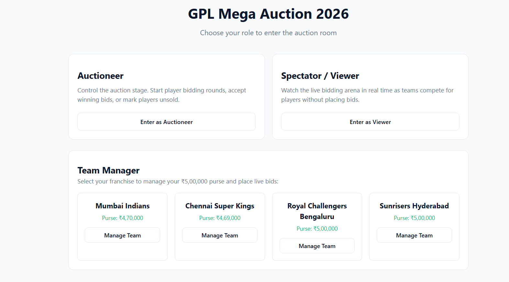
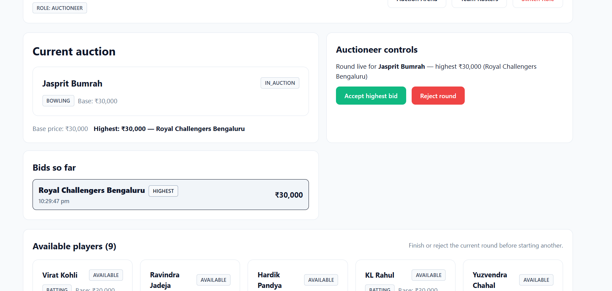
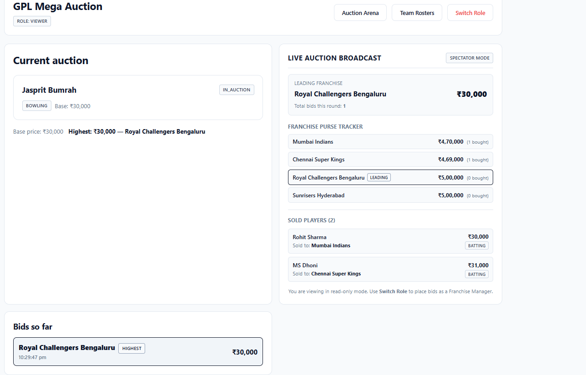
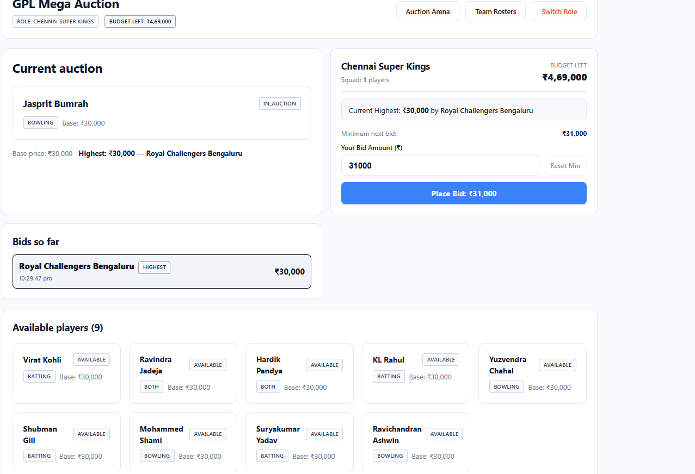
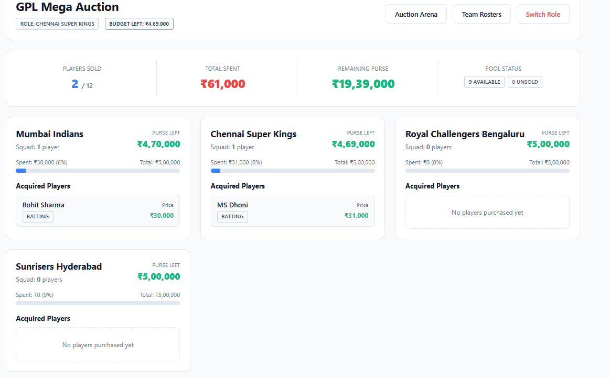

# GPL Mega Auction 2026

A real-time IPL-style player auction application. The auctioneer brings players to the podium, franchises place competitive bids, and the system tracks all budgets and rosters live.

---

## How to Run the App


### 1. Start the Backend (API Server)
```bash
cd server
npm install
npm run dev
```
Server runs at **http://localhost:5000**

### 2. Start the Frontend (React App)
Open a second terminal:
```bash
cd client
npm install
npm run dev
```
Frontend runs at **http://localhost:5173**

### 3. Open the App
Navigate to `http://localhost:5173` in your browser and select a role.

---

## Test Command

Automated test cases cover the bid rules, budget enforcement, and auctioneer accept/reject actions:

```bash
cd server
npm test
```

Test suite files located in [`server/tests/`](file:///c:/Users/HP/OneDrive/Desktop/Bluno/server/tests):
- [`bid.test.js`](file:///c:/Users/HP/OneDrive/Desktop/Bluno/server/tests/bid.test.js) — covers initial base price check, minimum increment (+1000), consecutive bid prevention, and budget limits.
- [`accept.test.js`](file:///c:/Users/HP/OneDrive/Desktop/Bluno/server/tests/accept.test.js) — covers player status transitions to `sold`, purse deduction, roster assignment, and round rejection.

---

## Roles

| Role | What they can do |
|---|---|
| **Auctioneer** | Start bidding rounds, pick players, accept winning bids, reject/pass rounds |
| **Team Manager** | Select a franchise, place live bids using the team purse |
| **Spectator / Viewer** | Watch the live auction, see sold player log and franchise purse tracker in real-time |

---

## Team Budgets & Bid Rules

### Team Budgets
All four franchises start with an equal purse:

| Franchise | Starting Budget |
|---|---|
| Mumbai Indians | Rs. 5,00,000 |
| Chennai Super Kings | Rs. 5,00,000 |
| Royal Challengers Bengaluru | Rs. 5,00,000 |
| Sunrisers Hyderabad | Rs. 5,00,000 |

### Bid Rules

1. **Base Price Floor**: The first bid in any round must be at least equal to the player's `base_price`.
2. **Minimum Increment**: Every subsequent bid must exceed the current highest bid by at least **Rs. 1,000**.
   - Formula: `newBid >= highestBid.amount + 1000`
3. **Budget Check**: A team cannot place a bid exceeding its `remainingBudget`. The server validates this and returns an error if violated.
4. **No Self-Outbidding**: A team cannot place a new bid if they already hold the highest bid (enforced on the frontend; the server would also reject it as the bid would not exceed itself by Rs. 1,000).
5. **Accept Rule**: The auctioneer can only accept a bid if at least one bid exists for the current round.
6. **Reject / Pass**: The auctioneer can reject a round at any time. The player's status returns to `available` and they re-enter the pool for a future round.
7. **Budget Deduction**: When a bid is accepted, `team.remainingBudget -= winningBid.amount` is applied immediately and persisted.

---

## API Documentation

All endpoints are prefixed with `/api`. The server runs on `http://localhost:5000`.

** The frontend polls `GET /api/auction` every **1 second** to get live updates.

---

### Players

#### `GET /api/players`
Returns all players in the pool.

**Request body:** none

**Success 200:**
```json
{
  "success": true,
  "data": [
    {
      "id": "Player-1",
      "name": "Virat Kohli",
      "skill": "batting",
      "base_price": 30000,
      "status": "available",
      "sold_price": null,
      "team_id": null
    }
  ]
}
```

**Errors:** none (always returns the full array)

---

### Teams

#### `GET /api/teams`
Returns all four franchises with their current budget state.

**Request body:** none

**Success 200:**
```json
{
  "success": true,
  "data": [
    {
      "id": "Team-1",
      "name": "Mumbai Indians",
      "totalBudget": 500000,
      "remainingBudget": 470000
    }
  ]
}
```

**Errors:** none

---

### Auction

#### `GET /api/auction`
Returns the current state of the auction round.

**Request body:** none

**Success 200:**
```json
{
  "success": true,
  "data": {
    "status": "active",
    "currentPlayer": {
      "id": "Player-4",
      "name": "Jasprit Bumrah",
      "skill": "bowling",
      "base_price": 30000,
      "status": "in_auction",
      "sold_price": null,
      "team_id": null
    },
    "bids": [
      {
        "id": "Bid-1791392387219",
        "playerId": "Player-4",
        "teamId": "Team-3",
        "teamName": "Royal Challengers Bengaluru",
        "amount": 30000,
        "timestamp": "2026-10-07T16:59:47.219Z"
      }
    ],
    "highestBid": {
      "id": "Bid-1791392387219",
      "playerId": "Player-4",
      "teamId": "Team-3",
      "teamName": "Royal Challengers Bengaluru",
      "amount": 30000,
      "timestamp": "2026-10-07T16:59:47.219Z"
    }
  }
}
```

When no round is active, `status` is `"idle"`, `currentPlayer` is `null`, `bids` is `[]`, and `highestBid` is `null`.

---

#### `POST /api/auction/start`
Starts a bidding round for a player.

**Request body (optional):**
```json
{ "playerId": "Player-4" }
```
If `playerId` is omitted, the next available player in the list is selected automatically.

**Success 200:**
```json
{
  "success": true,
  "message": "Auction started for Jasprit Bumrah",
  "data": {
    "player": { "id": "Player-4", "name": "Jasprit Bumrah", "status": "in_auction" },
    "auction": { "currentPlayerId": "Player-4", "status": "active" }
  }
}
```

**Errors:**

| Status | Condition | message |
|---|---|---|
| 400 | A round is already active | "An auction round is already active. Accept or reject it first." |
| 400 | No available players left | "No available players left to auction." |

---

#### `POST /api/auction/bid`
Places a bid for a team on the current active player.

**Request body:**
```json
{ "teamId": "Team-1", "amount": 35000 }
```

**Success 200:**
```json
{
  "success": true,
  "message": "Bid of Rs.35,000 placed by Mumbai Indians",
  "data": {
    "id": "Bid-1791399999999",
    "playerId": "Player-4",
    "teamId": "Team-1",
    "teamName": "Mumbai Indians",
    "amount": 35000,
    "timestamp": "2026-10-07T17:00:00.000Z"
  }
}
```

**Errors:**

| Status | Condition | message |
|---|---|---|
| 400 | teamId or amount missing | "teamId and amount are required." |
| 400 | No active auction round | "No active auction round currently." |
| 404 | teamId does not exist | "Team not found." |
| 400 | Bid below minimum required | "Bid must be at least Rs.{minBidRequired}" |
| 400 | Team has insufficient budget | "{teamName} does not have enough budget. Remaining: Rs.{remainingBudget}" |

---

#### `POST /api/auction/accept`
Accepts the current highest bid. Marks the player as sold, deducts the amount from the team purse, and resets the auction to idle.

**Request body:** none

**Success 200:**
```json
{
  "success": true,
  "message": "Jasprit Bumrah sold to Royal Challengers Bengaluru for Rs.30,000",
  "data": {
    "player": { "id": "Player-4", "status": "sold", "sold_price": 30000, "team_id": "Team-3" },
    "team": { "id": "Team-3", "name": "Royal Challengers Bengaluru", "remainingBudget": 470000 }
  }
}
```

**Errors:**

| Status | Condition | message |
|---|---|---|
| 400 | No active auction round | "No active auction round to finalize." |
| 400 | No bids placed yet | "No bids were placed for this player. Use reject/pass instead." |

---

#### `POST /api/auction/reject`
Rejects the current round. Returns the player to `available` status without selling and resets the auction to idle.

**Request body:** none

**Success 200:**
```json
{
  "success": true,
  "message": "Jasprit Bumrah returned to available pool",
  "data": {
    "player": { "id": "Player-4", "status": "available", "sold_price": null, "team_id": null }
  }
}
```

**Errors:**

| Status | Condition | message |
|---|---|---|
| 400 | No active auction round | "No active auction round to reject." |

---

## Database Schema

The app uses a **single JSON file** as its database: `server/data/db.json`.

It has four top-level keys: `teams`, `players`, `bids`, and `auction`.

---

### `teams` — Array of franchise objects

| Field | Type | Constraints |
|---|---|---|
| `id` | string (PK) | Unique, e.g. "Team-1" |
| `name` | string | Franchise name |
| `totalBudget` | number | Always 500000; never changes |
| `remainingBudget` | number | Starts at 500000; decremented on each accept |

**Constraint:** `0 <= remainingBudget <= totalBudget` (enforced by bid validation).

---

### `players` — Array of player objects

| Field | Type | Constraints |
|---|---|---|
| `id` | string (PK) | Unique, e.g. "Player-1" |
| `name` | string | Player full name |
| `skill` | string (enum) | One of: "batting", "bowling", "both" |
| `base_price` | number | Minimum opening bid; never changes |
| `status` | string (enum) | One of: "available", "in_auction", "sold", "unsold" |
| `sold_price` | number or null | Set when accepted; null otherwise |
| `team_id` | string or null (FK -> teams.id) | Set when accepted; null otherwise |

**Status transitions:**
```
available  --[startAuction]-->  in_auction
in_auction --[acceptBid]-->     sold
in_auction --[rejectRound]-->   available
```

---

### `bids` — Array of all bids across all rounds

| Field | Type | Constraints |
|---|---|---|
| `id` | string (PK) | Auto-generated: "Bid-{Date.now()}" |
| `playerId` | string (FK -> players.id) | Player being bid on |
| `teamId` | string (FK -> teams.id) | Team placing the bid |
| `teamName` | string | Denormalised team name for fast display |
| `amount` | number | Must be >= base_price (first bid) or >= highestBid + 1000 |
| `timestamp` | string (ISO 8601) | UTC datetime of the bid |

**Note:** Bids are never deleted. All historical bids from every round persist.

---

### `auction` — Single object representing the active round

| Field | Type | Constraints |
|---|---|---|
| `currentPlayerId` | string or null (FK -> players.id) | null when idle |
| `status` | string (enum) | Either "active" or "idle" |

---

### Full `db.json` structure example

```json
{
  "teams": [
    {
      "id": "Team-1",
      "name": "Mumbai Indians",
      "totalBudget": 500000,
      "remainingBudget": 470000
    }
  ],
  "players": [
    {
      "id": "Player-1",
      "name": "Virat Kohli",
      "skill": "batting",
      "base_price": 30000,
      "status": "available",
      "sold_price": null,
      "team_id": null
    },
    {
      "id": "Player-2",
      "name": "Rohit Sharma",
      "skill": "batting",
      "base_price": 30000,
      "status": "sold",
      "sold_price": 30000,
      "team_id": "Team-1"
    }
  ],
  "bids": [
    {
      "id": "Bid-1791389738375",
      "playerId": "Player-2",
      "teamId": "Team-1",
      "teamName": "Mumbai Indians",
      "amount": 30000,
      "timestamp": "2026-10-07T16:15:38.375Z"
    }
  ],
  "auction": {
    "currentPlayerId": null,
    "status": "idle"
  }
}
```


screenshots




